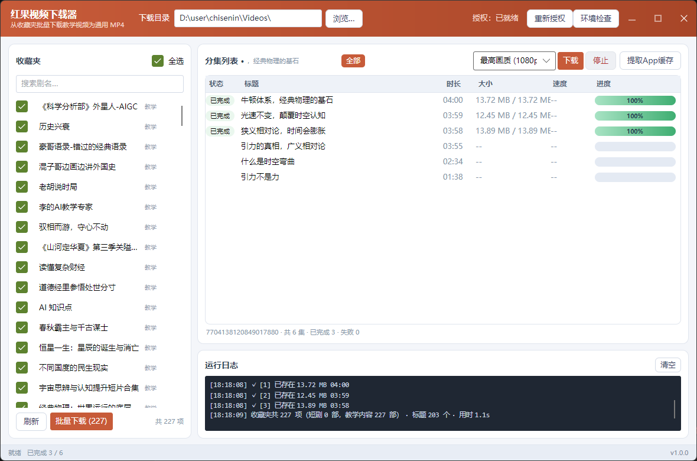

# 红果视频下载器 —— C# / Avalonia 界面版（发行版）

用 **C# + Avalonia 11** 写的界面层，产出**自包含单文件** exe：
`hgvd-downloader-v1.1.1.exe`（约 46 MB，目标机不用装 .NET）。

> 本版与 Python 版（[`../hgvd/`](../hgvd/)）**共用同一套核心**
> （`../hgvd-csharp/src/Hgvd.Core`：签名链、下载器、配置目录），
> 登录态 / 设备档案 / 下载历史可以直接互换。
> Python 版负责快速验证接口与算法，本版负责日常使用。



---

## 一、为什么用 Avalonia

Avalonia 是跨平台 UI 框架（Windows / Linux / macOS 同一套 XAML）。
本版把界面层整个换成 Avalonia，**核心一行没改** —— 这是能快速验证等价性的原因。

| | Python 版 | 本版（C# + Avalonia） |
|---|---|---|
| 形态 | 脚本 + 本地网页界面 | 单文件 exe |
| 依赖 | 极少（requests 等） | 目标机零依赖（自包含） |
| 界面 | 浏览器渲染 | 原生窗口 |
| 用途 | **想法验证**：改逻辑快 | **发行版**：日常使用 |

---

## 二、构建

```bat
build.cmd                :: 发布 Release（输出到 dist\）
build.cmd selftest       :: 无头跑一遍收藏夹 / 分集 / 播放地址
```

Git Bash / MSYS 里用等价脚本：

```bash
./build.sh
./build.sh selftest
```

**依赖**：.NET 8 SDK + NuGet 源（`NuGet.config` 已配好镜像）。

> ★ `NuGet.config` 放在本目录，但被引用的 `Hgvd.Core` 在 `../hgvd-csharp/` 下 ——
>   NuGet 配置是**按项目目录向上查找**的，所以发布前必须显式
>   `dotnet restore --configfile NuGet.config -r win-x64`（脚本已经带上了）。
>   少了这一步会报 `NU1100：无法解析 Microsoft.NETCore.App.Runtime.win-x64`。

### 成品命名与版本号

产物固定叫 **`hgvd-downloader-vX.Y.Z.exe`**。
版本号唯一来源 = `build.cmd` / `build.sh` 里的 `VER`
（等价于 csproj 的 `PkgVersion`，同时决定**程序集版本**，
界面右下角的版本号读的就是它）。

在 CI 里由**标签**决定：`git tag v1.0.1` ⇒ 产物 `hgvd-downloader-v1.0.1.exe`，
界面显示 `v1.0.1`。

---

## 三、命令行自检

```bash
hgvd-downloader-v1.1.1.exe --selftest [series_id]   # 收藏夹 → 分集 → 播放地址
hgvd-downloader-v1.1.1.exe --uitest                 # 界面交互自检
hgvd-downloader-v1.1.1.exe --batchtest [部数]        # 批量下载冒烟测试
hgvd-downloader-v1.1.1.exe --demo <series_id> [skip] # 加载一部剧并真的开始下载（便于截图）
```

> ★ 程序是 `WinExe`（没有控制台），启动时会 `AttachConsole` 挂上父进程的控制台，
>   所以从 cmd 里跑能看到输出；控制台编码强制 UTF-8，中文不乱码。

`--uitest` 覆盖的交互点：

```
[✓] 收藏夹已加载
[✓] 剧名已补齐（批量 + album_detail 回落）
[✓] 收藏夹默认未勾选（0/236）
[✓] 右栏清单初始为空
[✓] 点列表行不再触发加载
[✓] 能定位到行内复选框
[✓] 勾选剧目 → 分集进清单 / 有分组标题行
[✓] 勾第二部 → 第一部仍在清单里（追加不替换）/ 两部剧都在清单里
[✓] 分组标题行随部数增加 / 各剧分集序号独立（都从 1 开始）
[✓] 取消勾选 → 该剧移出清单 / 另一部仍在清单里 / 标题行同步
[✓] 清单里确实有待下载分集 / 下载跑遍了清单里的每一集
[✓] 状态都标为已完成 / 各剧集号独立、不串号
[✓] 状态栏统计与清单一致
[✓] 状态栏右侧显示版本号
[✓] 下载目录改文本框即生效
[✓] logo 区单击打开「关于」
```

---

## 四、Avalonia 踩坑要点

下面是实际踩到的坑，代码里都有对应注释。

### 4.1 XAML 层

| 常见写法 | Avalonia 里的写法 | 说明 |
|---|---|---|
| `ToolTip="..."` | `ToolTip.Tip="..."` | ToolTip 是附加属性，写成属性直接编译失败 |
| `DataTrigger` | 换成 VM 上直接暴露 `bool` / `IBrush` | Avalonia 没有 DataTrigger |
| `<Window>` 下两个子元素 | 必须**只有一个**根子元素 | 否则报 `AVLN3000: Content 无法多次赋值` |
| `GridView` + `GridViewColumn` | 手写 `Grid`（列定义 `58,Auto,54,126,74,136`） | 不引 DataGrid 包，列宽全部算死，标题列由代码算 |
| `CollectionViewSource` 过滤 | 手工维护一份 `EpisodeView` 集合 | Avalonia 的 `ICollectionView` 不好用 |
| `MessageBox.Show` | 自写 `MsgBox`（纯代码搭窗口） | Avalonia 没有内置 MessageBox |
| WinForms `FolderBrowserDialog` | `StorageProvider.OpenFolderPickerAsync` | 跨平台版；`IStorageFolder.Path.LocalPath` 是本地路径 |
| `TextBox.AppendText` | `TxtLog.Text += ...` + `CaretIndex = 长度` | Avalonia 没有 AppendText |
| `Mouse.Capture` | `e.Pointer.Capture(this)` | |
| `StaticResource` | 改 `DynamicResource` | 窗口在运行时创建，App 级资源用 StaticResource 可能找不到 |
| `TextBox` 无 `CornerRadius` | 保持 Fluent 默认模板，只改配色 | 自写 TextBox 模板容易踩模板部件的坑 |

### 4.2 C# 层

- **`Avalonia 11 没有 `ButtonBase`** —— `Button : ContentControl`，`ClickEvent` 在 `Button` 上。
  勾选框的 Click 事件要 `new RoutedEventArgs(Button.ClickEvent)`。
- **`Window.BeginResizeDrag(WindowEdge, PointerPressedEventArgs)`** —— 枚举叫 `WindowEdge`
  （`NorthWest/North/NorthEast/West/East/SouthWest/South/SouthEast`），而且**要传事件参数**。
- **`Application` 上没有 `MainWindow` / `Shutdown`** —— 在
  `IClassicDesktopStyleApplicationLifetime` 上（`life.MainWindow = w` / `life.TryShutdown(0)`）。
- **`Application.TryFindResource` 不存在** —— 用 `Application.Current.Resources.TryGetValue(key, out var v)`。
- **后台线程不能调 `Window.Show()`** —— 抛 `InvalidOperationException: Call from invalid thread`。
  自检模式要用 `Dispatcher.UIThread.Post(async () => ...)`。
- **配色统一放 `Application.Resources`**，`DynamicResource` + `Palette.Brush(key)` 取用，
  避免同一份配色在 XAML 和 C# 里各写一遍。

### 4.3 自定义控件：容器型子控件别用 Left/Right 对齐

`ProgressCell`（进度条单元格）踩过一次很隐蔽的坑：

> `Border` 没有子内容 ⇒ `DesiredSize` 恒为 `(0,0)`。
> 填充层设了 `HorizontalAlignment = Left` 且**从未被 Measure** ⇒
> Avalonia 排版时把宽度收缩到 `DesiredSize.Width` = **0**
> ⇒ **整块渐变填充被压成 0 宽**，界面上只剩一条空轨道，看起来像"渐变没实现"。

★ **教训**：自定义控件里，容器型子控件**要么显式 Measure，要么用 `Stretch`**。
另外，界面效果"没出来"时，先**证明它到底画出来没有**（抓像素看颜色），
再证明状态对不对，最后才改 —— 只看代码容易把方向判错。

### 4.4 界面细节

- **列表项不会被拉伸**：Avalonia 的 `ListBoxItem` 内容默认按内容宽度排版，
  右边的标签会被挤出面板。
  ⇒ 剧名列的宽度由代码按 `LstShelf.Bounds.Width` 算好，统一写进每一行。
- **跑马灯**：用 `TextBlock + 位移` 实现，不自己 `DrawText`，前景色取灰蓝 `#8494A8`。
- **进度条**：不用 Avalonia 自带 `ProgressBar`（模板部件随版本变动），
  改成自写 `ProgressCell`（`Panel` + 两个 `Border` + 一个 `TextBlock`），
  渐变填充，百分比居中压在条上。
- **窗口按钮**：图标是**矢量自绘**（`WindowButton.Render` 覆写），
  不用字体字形 —— 字体缺字形会渲染成豆腐块。

---

## 五、目录结构

```
hgvd-avalonia/
├── NuGet.config              # NuGet 镜像（发布时要用 --configfile 指定）
├── Directory.Build.props     # Release：win-x64 / 自包含 / 单文件
├── build.cmd / build.sh      # 构建脚本
└── src/Hgvd.Avalonia/
    ├── Program.cs            # 入口（挂父进程控制台 + UTF-8 输出）
    ├── App.axaml / .cs       # 全局配色与控件样式 + 命令行开关分发
    ├── Controls/
    │   ├── WindowButton.cs   # 矢量自绘窗口按钮
    │   ├── MarqueeControl.cs # 跑马灯
    │   ├── ProgressCell.cs   # 进度条单元格
    │   └── Palette.cs        # 资源取画刷的小工具
    ├── ViewModels/
    │   ├── NotifyBase.cs
    │   ├── ShelfRow.cs       # 左栏一行
    │   └── EpisodeRow.cs     # 右栏一行
    └── Views/
        ├── MainWindow.axaml / .cs
        ├── MainWindow.SelfTest.cs   # --selftest / --uitest / --batchtest / --demo
        ├── AboutWindow.axaml / .cs
        └── MsgBox.cs                # Avalonia 没有 MessageBox，自己搭
```

---

## 六、已知限制

- **核心层仍是 Windows 专用**：`MumuAuth`（读 MuMu 模拟器登录态）、`CacheExtract`
  都是 Windows 专属路径。界面层跨平台，**下载链路目前只能在 Windows 上跑**。
- **播放接口的「空 body」是症状，不是根因** —— 拿到 JSON（哪怕 `code≠0`）说明签名是通的；
  `code=101000` 是 `video_id_type` 用错；只有零字节 body 才是服务端把请求丢弃了。
  ★ **不要**把空 body 笼统写成「服务端限流」。
  详见 [`../docs/01-接口与签名.md`](../docs/01-接口与签名.md)。
- 急用可走「提取 App 缓存」—— 那条路**完全不需要** `video_model`、不需要签名。
- Avalonia 的 `ListBox` 选中态样式与 Fluent 默认略有差异，
  已用 `ListBox.shelf ListBoxItem` / `ListBox.ep ListBoxItem` 后代选择器覆盖。
